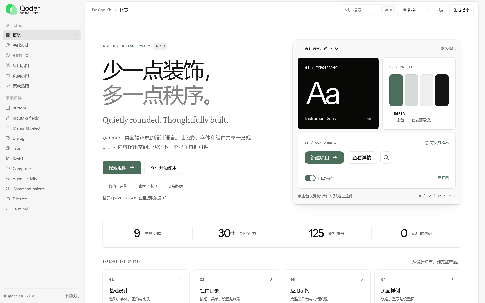
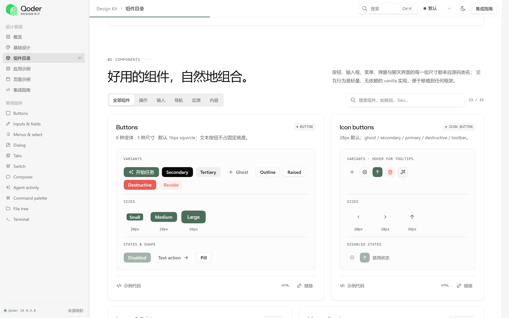
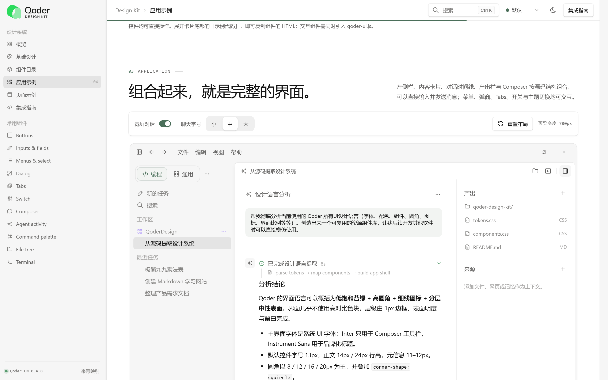
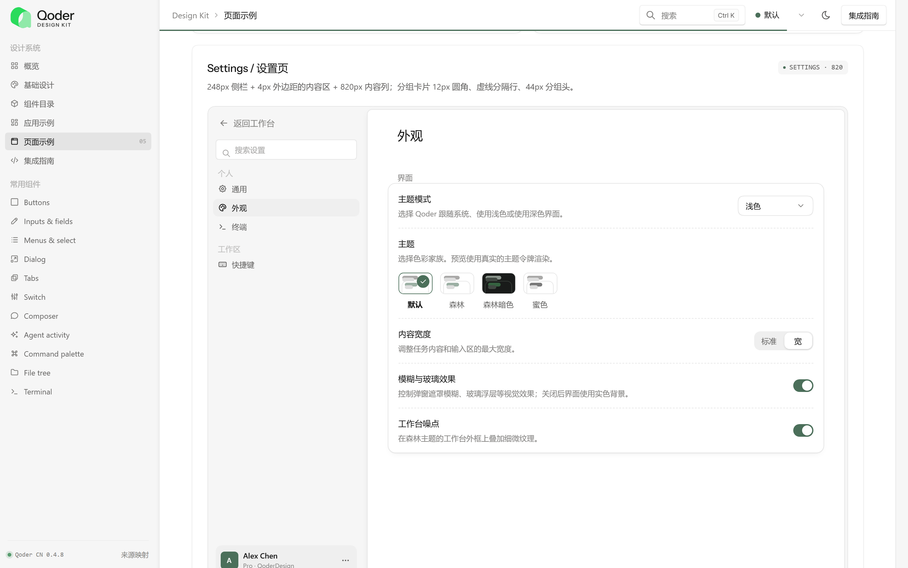

<div align="center">

<picture>
  <source media="(prefers-color-scheme: dark)" srcset="assets/brand/qoder-design-kit-dark.svg">
  
</picture>

<p>A zero-build UI design system reconstructed from Qoder's compiled source — tokens, themes, components and icons.</p>

[](LICENSE)
[](SOURCE-MAPPING.md)
[](package.json)

[Showcase](index.html) · [Guide](GUIDE.md) · [Integration](INTEGRATION.md) · [Source Mapping](SOURCE-MAPPING.md) · [Starter](examples/starter.html)

</div>

<br>

<picture>
  <source media="(prefers-color-scheme: dark)" srcset="docs/screenshots/hero-dark.png">
  
</picture>

## Overview

Qoder Design Kit 是一套从 **Qoder CN 0.4.8** 编译产物中逐项还原的 UI 设计系统。

它不依赖截图临摹：颜色、字体、尺寸、圆角、阴影与组件配方均提取自 renderer CSS 与 React 组件的 className，每一个数值都能在 [SOURCE-MAPPING.md](SOURCE-MAPPING.md) 中追溯到出处。交互部分以无依赖的 vanilla JS 重写，可移植到任意技术栈。

- **源码级令牌** — 哈希 CSS 变量与语义类名对照，生成可移植的 [`tokens.json`](tokens.json)
- **九套主题** — Default、Forest、Bee、Mint、Parchment 的亮暗组合
- **30+ 组件** — 从 Button、Dialog 到 Composer、File tree、Terminal、Settings
- **125 枚图标** — 110 outline + 15 filled，内联 SVG 精灵
- **零构建** — 两个 CSS 与两个 JS 文件，直接打开 `index.html` 即可运行

## Getting Started

```bash
git clone https://github.com/wintopic/QoderDesign.git
cd QoderDesign
npm start
```

打开 <http://localhost:4173>。`npm start` 不需要安装任何依赖；也可以使用 `npx serve .` 或 `python -m http.server 4173`。

### Installation

将 `assets/` 复制到项目中，引入以下四个文件：

```html
<link rel="stylesheet" href="assets/css/tokens.css">
<link rel="stylesheet" href="assets/css/components.css">
<script src="assets/js/qoder-icons.js"></script>
<script src="assets/js/qoder-ui.js"></script>
```

### Usage

```html
<button class="q-btn q-btn--primary">
  <svg class="q-icon"><use href="#q-i-sparkles"></use></svg>
  开始任务
</button>
```

```js
QTheme.set('forest-dark');

QToast.show({
  title: '已保存',
  description: '主题令牌已写入。',
  type: 'success'
});
```

React 与 Vue 封装示例位于 [`examples/`](examples)，完整接入说明见 [INTEGRATION.md](INTEGRATION.md)。

## Components

<picture>
  <source media="(prefers-color-scheme: dark)" srcset="docs/screenshots/components-dark.png">
  
</picture>

| Category | Components |
|---|---|
| Inputs | Button, IconButton, Input, Textarea, Select, Checkbox, Radio, Switch, Slider |
| Overlays | Menu, Context menu, Dialog, Tooltip, Hover card, Toast, Command palette |
| Feedback | Alert, Loader, Boot splash, Empty state, Chart, Kbd |
| Workbench | Sidebar, Workbench frame, Tabs, File tree, Terminal, Settings, Theme preview |
| Agent | Composer, Context chips, Messages, Agent activity, Welcome, Auth |

每个组件的尺寸规格与源码依据见 [GUIDE.md § 组件规格](GUIDE.md#4-组件规格)，JavaScript API 见 [GUIDE.md § 交互 API](GUIDE.md#6-交互-api)。

## Application Shell

完整的工作台示例：侧栏、对话时间线、产出栏与 Composer 均按源码结构组合，可直接交互。

<picture>
  <source media="(prefers-color-scheme: dark)" srcset="docs/screenshots/app-dark.png">
  
</picture>

## Design Principles

1. **表面优先于阴影。** 层级由表面明度与 1px 低对比边框建立，只有浮层使用明显阴影。
2. **一个主色。** 苔绿 `#4B6F5A` 仅用于主要动作与品牌，其余色彩只表达状态和数据。
3. **柔和的圆角。** 8 / 12 / 16 / 20px 四级，并叠加 `corner-shape: squircle`。
4. **13px 信息密度。** 依靠行高而非字重区分层级。

| Token | Value | Token | Value |
|---|---|---|---|
| Title bar | 40px | Chat column | 768px / 968px |
| Sidebar | 248px (208–420) | Composer | min 120px, radius 20 |
| Artifacts panel | 280px | Min window | 720 × 540 |

字体、颜色、阴影、动效与加载动画的完整说明见 [GUIDE.md § 设计语言](GUIDE.md#3-设计语言)。

## Theming

```
light          forest-light     bee-light     mint-light     light-parchment
               forest-dark      bee-dark      mint-dark      parchment-dark
```

通过 `QTheme.set(id)` 或 URL 参数 `?theme=mint-dark` 切换。新增主题与修改主色见 [GUIDE.md § 自定义](GUIDE.md#8-自定义)。

<picture>
  <source media="(prefers-color-scheme: dark)" srcset="docs/screenshots/settings-dark.png">
  
</picture>

## Methodology

```
Qoder CN 0.4.8 (Electron)
└── app.asar
    ├── renderer CSS       → 哈希变量 ⇄ 语义类名 → 语义令牌
    ├── data-theme 选择器   → tokens.json（九套主题）
    ├── React chunks        → 组件 className → 零依赖 CSS / JS
    └── electronMain.js     → 窗口与标题栏尺寸
```

结构与交互通过无头浏览器验证，截图仅用于最终视觉对照。提取脚本位于 [`tools/`](tools)，原始数据与验证记录位于 [`source-evidence/`](source-evidence)。

## Project Structure

```
.
├── index.html            Interactive showcase
├── tokens.json           Semantic tokens for all nine themes
├── assets/
│   ├── css/              tokens.css, components.css (library) · showcase*.css (site)
│   ├── js/               qoder-icons.js, qoder-ui.js (library) · showcase*.js (site)
│   ├── icons/            outline/, filled/, sprite.svg
│   ├── fonts/            Inter, Instrument Sans, Crimson Pro
│   └── brand/            Logo assets
├── examples/             Starter page, React and Vue wrappers
├── tests/                Playwright specs
├── tools/                Dev server and extraction scripts
├── source-evidence/      Extracted data and verification records
└── licenses/             Third-party licenses
```

## Testing

```bash
npm install
npm run test:install
npm test
```

测试基于 Playwright，并使用 axe-core 进行可访问性审查。

## Limitations

- 交互为轻量 vanilla 实现，不包含 Qoder 的 React、Radix 或 Motion 代码。
- 图标以 Tabler Icons 等价替换 Qoder 自研图标，个别轮廓存在差异。
- 部分原始令牌未达到 WCAG 文字对比度要求，本项目保留源值。
- 数值对应 Qoder CN 0.4.8，后续版本可能变化。

完整列表见 [GUIDE.md § 已知差异与边界](GUIDE.md#9-已知差异与边界)。

## Contributing

欢迎提交 Issue 与 Pull Request。开始之前请阅读 [CONTRIBUTING.md](CONTRIBUTING.md)。

## License

代码与文档以 [MIT](LICENSE) 许可发布。字体 Inter、Instrument Sans、Crimson Pro 采用 SIL OFL 1.1，图标 Tabler Icons 采用 MIT，原文见 [`licenses/`](licenses)。

本项目为非官方设计参考，与 Qoder 不存在隶属关系。Qoder 名称与标志归其权利人所有，不在本项目许可范围内，详见 [BRAND.md](BRAND.md)。
