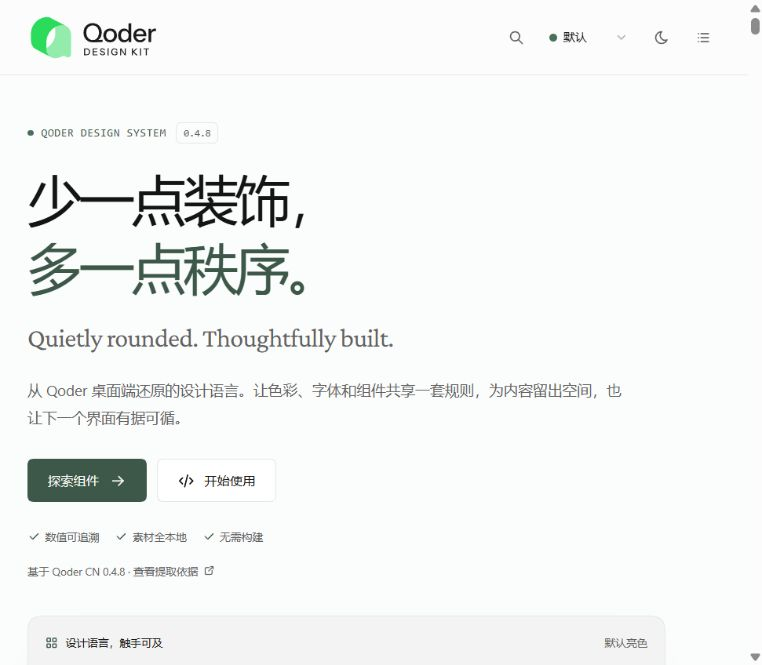

<div align="center">


### 从 Qoder 编译产物中逐项还原的零构建 UI 设计系统

**源码级令牌 · 9 套主题 · 30+ 组件 · 125 枚图标 · 纯 CSS + Vanilla JS**

[](LICENSE)


[](CONTRIBUTING.md)

[在线展示](index.html) · [完整指南](GUIDE.md) · [集成指南](INTEGRATION.md) · [源码映射](SOURCE-MAPPING.md) · [Starter 模板](examples/starter.html)



</div>

---

## ✨ 为什么是它

大多数「仿 XX 风格」的 UI 库靠截图临摹。**Qoder Design Kit 不是。**

所有颜色、字体、尺寸、圆角、阴影和组件配方，都来自 Qoder CN 0.4.8 的 renderer CSS 与 React 组件 className —— 每个数值都能在 [SOURCE-MAPPING.md](SOURCE-MAPPING.md) 里找到出处。

| | |
|---|---|
| 🎯 **源码级还原** | 哈希 CSS 变量 → 语义令牌映射，视觉值与原版一致 |
| ⚡ **零构建、零依赖** | 两个 CSS + 两个 JS，双击 `index.html` 即可运行 |
| 🎨 **9 套主题** | 亮 / 暗 × Forest、Bee、Mint、Parchment，一行代码切换 |
| 🧩 **30+ 组件** | Button、Dialog、Composer、Settings、File tree、Terminal、Chart… |
| 🔣 **125 枚图标** | 110 outline + 15 filled，内联 SVG 精灵，中英文检索 |
| 📦 **可移植令牌** | `tokens.json` 可直接导入 Figma / Style Dictionary / 其他技术栈 |
| ✅ **自动化验证** | Playwright 交互回归 + axe-core 可访问性审查 |

## 🚀 快速开始

```bash
git clone https://github.com/wintopic/QoderDesign.git
cd QoderDesign
npm start            # 无需安装依赖 → http://localhost:4173
```

或者任意静态服务器：`npx serve .` / `python -m http.server 4173`。

### 引入到你的项目

只需要四个文件：

```html
<link rel="stylesheet" href="assets/css/tokens.css">
<link rel="stylesheet" href="assets/css/components.css">
<script src="assets/js/qoder-icons.js"></script>
<script src="assets/js/qoder-ui.js"></script>
```

```html
<button class="q-btn q-btn--primary">
  <svg class="q-icon"><use href="#q-i-sparkles"></use></svg>
  开始任务
</button>
```

```js
QTheme.set('forest-dark');

QToast.show({ title: '已保存', description: '主题令牌已写入。', type: 'success' });
```

React / Vue 示例见 [`examples/`](examples)，完整接入方式见 [INTEGRATION.md](INTEGRATION.md)。

## 🎨 设计语言

> **低饱和苔绿、柔和圆形、细线图标、分层中性表面、13px 信息密度。**

1. **表面优先于阴影** —— 层级由表面明度与 1px 低对比边框建立，只有浮层才有明显阴影。
2. **一个有记忆点的颜色** —— 苔绿 `#4B6F5A` 只承担主要动作和品牌。
3. **圆角要「软」不要「弹」** —— 8 / 12 / 16 / 20px，统一叠加 `corner-shape: squircle`。
4. **13px 的密度** —— 靠行高而非粗体区分层级。

| 区域 | 数值 | 区域 | 数值 |
|---|---|---|---|
| 标题栏 | 40px | 对话列 | 768 / 968px |
| 左侧栏 | 248px（208–420） | Composer | min 120px · r20 |
| 右侧任务栏 | 280px | 窗口最小 | 720 × 540 |

更多：字体、颜色、阴影、动效、Loading、玻璃与噪点 → [GUIDE.md §3](GUIDE.md#3-设计语言)

## 🧩 组件

<table>
<tr><td><b>基础</b></td><td>Button · IconButton · Input · Textarea · Select · Checkbox · Radio · Switch · Slider · Kbd</td></tr>
<tr><td><b>浮层</b></td><td>Menu · Context menu · Dialog · Tooltip · Hover card · Toast · Command palette</td></tr>
<tr><td><b>反馈</b></td><td>Alert · Loader / Boot splash · Empty state · Chart</td></tr>
<tr><td><b>工作台</b></td><td>Sidebar · Workbench frame · Tabs · File tree · Terminal · Settings page · Theme preview</td></tr>
<tr><td><b>Agent</b></td><td>Composer · Context chips · User message · Assistant prose · Agent activity · Welcome · Auth</td></tr>
</table>

每个组件的尺寸规格与源码依据 → [GUIDE.md §4](GUIDE.md#4-组件规格)；交互 API（`QTheme` / `QToast` / 声明式标记 / 自定义事件）→ [GUIDE.md §6](GUIDE.md#6-交互-api)

## 🌗 主题

```
light · forest-light · bee-light · mint-light · light-parchment
forest-dark · bee-dark · mint-dark · parchment-dark
```

```js
QTheme.set('mint-dark');      // 或 index.html?theme=mint-dark
```

## 📁 项目结构

```
├─ index.html              交互式展示站（文档 + 全部组件示例）
├─ tokens.json             九套主题的语义令牌
├─ assets/
│  ├─ css/                 tokens.css · components.css（库）/ showcase*.css（展示站）
│  ├─ js/                  qoder-icons.js · qoder-ui.js（库）/ showcase*.js（展示站）
│  ├─ icons/               outline/ · filled/ · sprite.svg
│  ├─ fonts/               Inter · Instrument Sans · Crimson Pro（woff2）
│  └─ brand/               Logo 资产
├─ examples/               Starter 页面 · React · Vue
├─ tests/                  Playwright 交互与展示回归
├─ tools/                  本地服务 · 源码提取脚本
├─ source-evidence/        提取数据与验证截图
└─ licenses/               第三方许可证原文
```

## 🔬 还原方法

```
Qoder CN 0.4.8 (Electron)
  └─ app.asar → renderer CSS + React chunks + electronMain.js
       ├─ 哈希变量 ⇄ Tailwind 语义类  →  语义令牌映射
       ├─ data-theme 选择器块          →  tokens.json（9 套主题）
       ├─ Button / Workbench / Composer className  →  零依赖 CSS/JS 重写
       └─ 无头浏览器结构 & 交互验证（截图仅作最终对照）
```

详见 [SOURCE-MAPPING.md](SOURCE-MAPPING.md)；提取脚本位于 [`tools/`](tools)。

## 🧪 测试

```bash
npm install
npm run test:install   # 安装 Chromium
npm test               # Playwright + axe-core
```

## ⚠️ 已知边界

- 交互为轻量 vanilla 重写，不复用 Qoder 的 React / Radix / Motion 代码。
- 图标用 Tabler Icons 等价替换 Qoder 自研图标。
- 部分原始令牌未达 WCAG 对比度，本项目保留源值。
- 对应 Qoder CN **0.4.8**，新版本可能存在差异。

完整列表 → [GUIDE.md §9](GUIDE.md#9-已知差异与边界)

## 🤝 参与贡献

欢迎 Issue 与 PR！请先阅读 [CONTRIBUTING.md](CONTRIBUTING.md)。

## 📄 许可

- 代码与文档：[MIT](LICENSE)
- 字体 Inter / Instrument Sans / Crimson Pro：SIL OFL 1.1；图标 Tabler Icons：MIT —— 见 [licenses/](licenses)

> **免责声明**：本项目是**非官方**的设计参考，与 Qoder 无任何隶属关系。Qoder 名称与标志归其权利人所有，不在本项目许可范围内。详见 [BRAND.md](BRAND.md)。

<div align="center">

如果这个项目对你有帮助，欢迎点一个 ⭐

</div>
